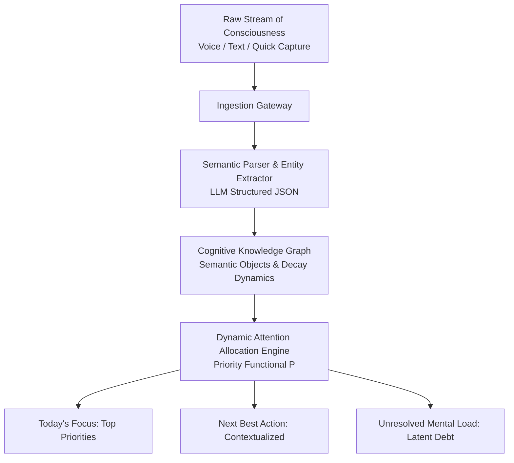

# SourceOS: Systems Architecture & Cognitive Engine Specification

**Author:** Larry Arnold  
**Affiliation:** Founder, LA Builds & Systems Architect  
**Date:** June 2026 (Revised: October 2026)  
**Target Venue:** Systems Architecture Whitepaper, ACM SIGCHI / Human-AI Interaction, Open Systems Specification  

---

## Executive Summary

Current productivity and knowledge tools force humans to act like database administrators for their own thoughts—demanding manual categorization, tagging, folder filing, and schedule juggling. This imposes substantial cognitive friction.

**SourceOS** is an AI-native system architecture designed to act as an externalized **digital prefrontal cortex**. SourceOS implements a continuous five-stage cognitive pipeline: frictionless capture of unconstrained thoughts, automated ontological extraction into six primitive schema classes (Thought, Task, Idea, Goal, Commitment, Person), temporal memory decay modeling, and multi-factor attention allocation. Rather than optimizing for organizational complexity, SourceOS optimizes for **cognitive relief**—explicitly surfacing what to ignore, calculating latent mental load, and generating the single highest-leverage next action.

---

## 1. Architectural Pipeline

1. **Frictionless Ingestion:** Zero-classification entry. Auto-focused single-line capture accepting rapid thoughts, stream-of-consciousness drafts, or voice audio transcripts.
2. **Semantic Extraction:** Deconstructs inputs into discrete typed objects with inferred urgency, goal relationships, and cognitive friction scores.
3. **Graph Storage & Temporal Decay:** Nodes decay naturally over time unless reinforced, mimicking biological working memory retention.
4. **Attention Ranking:** Balances deadlines, theme relevance, and emotional drag.
5. **Executive Action Surface:** Synthesizes clear guidance without overwhelming dashboards.

---

## 2. Ontological Schema

Every parsed item is instantiated as an instance of one of six core classes:

| Class | Semantics | Lifecycle Behavior |
| :--- | :--- | :--- |
| **Thought** | Ephemeral reflections, observations | Decays quickly; acts as ambient background context |
| **Task** | Actionable units of execution | Has completion criteria, urgency curves, and dependencies |
| **Idea** | Creative concepts, architectural sparks | Incubates; connects via semantic similarity to goals |
| **Goal** | High-level macroscopic outcomes | Anchors task trees; provides importance weighting |
| **Commitment** | Obligations made to external stakeholders | Carries high social accountability weight |
| **Person** | Collaborators, team members, contacts | Linked to tasks, meetings, and commitments |

---

## 3. Attention Allocation & Priority Functional

Priority is not a static flag (Low/Medium/High). It is computed continuously as:

$$\mathcal{P}(O, t) = w_I \cdot \mathcal{I}(O) + w_U \cdot \mathcal{U}(O, t) + w_A \cdot \mathcal{A}(O, \mathcal{G}_{\text{themes}}) + w_E \cdot \mathcal{E}(O) - \lambda \cdot \Delta t$$

Where:
- $\mathcal{I}(O) \in [0, 1]$: Intrinsic importance linked to top-level active goals.
- $\mathcal{U}(O, t)$: Temporal urgency with hyperbolic deadline discounting:
  $$\mathcal{U}(O, t) = \frac{1}{1 + \gamma (t_{\text{deadline}} - t)}$$
- $\mathcal{A}(O, \mathcal{G}_{\text{themes}})$: Cosine similarity between entity embedding and active strategic focus areas.
- $\mathcal{E}(O)$: Emotional drag / cognitive friction score.
- $\lambda \Delta t$: Natural decay discount for stale thoughts.

---

## 4. The Unresolved Mental Load Metric

SourceOS tracks cumulative unaddressed cognitive debt:

$$\mathcal{L}_{\text{mental}}(t) = \sum_{O_i \in \text{Unresolved}} \mathcal{E}(O_i) \cdot \ln(1 + \Delta t_i)$$

This isolates tasks and commitments that have lingered without resolution, prompting the user with explicit actions: **Execute now**, **Delegate**, or **Consciously Archive**.

---

## 5. Reference Implementation Stack

- **Ingress Gateway:** FastAPI / Node.js WebSocket stream receiver.
- **LLM Decomposition:** Claude 3.5 Sonnet / GPT-4o structured extraction prompts.
- **Vector & Graph Engine:** PostgreSQL with `pgvector` for semantic embeddings + relational graph schema.
- **Executive Frontend:** Minimalist Next.js / Tailwind desktop view focused on clarity and low visual noise.

---

## References

1. J. Sweller, "Cognitive load during problem solving: Effects on learning," *Cognitive Science*, 12(2):257–285 (1988).
2. H. A. Simon, *Designing Organizations for an Information-Rich World*, Johns Hopkins University Press (1971).
3. D. Allen, *Getting Things Done: The Art of Stress-Free Productivity*, Penguin (2001).
4. E. Horvitz, "Principles of mixed-initiative user interfaces," *Proceedings of ACM SIGCHI*, 159–166 (1999).
5. A. Baddeley, "Working memory," *Science*, 255(5044):556–559 (1992).
